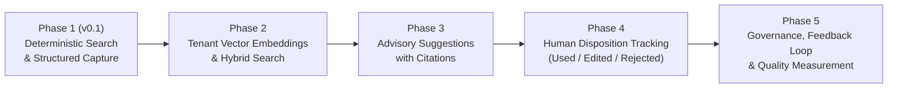

# Community Service Desk - AI Integration Roadmap & Principles

**Version:** 0.1.1  
**Status:** Architectural Blueprint (v0.1 implements Phase 1 deterministic retrieval; no external model calls)

---

## 1. Core Architectural Principle

> **Every resolved ticket should make the system better at helping resolve the next ticket.**

Community organizations and small support teams frequently solve the same recurring problems—printer configuration drops, account permissions drift, HVAC scheduling, or network authentication timeouts. 

In Community Service Desk, resolved tickets with structured root causes and steps are preserved as institutional knowledge. A future AI advisory layer will assist human support agents by proposing draft responses based on verified historical evidence.

---

## 2. Inviolable Governance Principles

Future AI features must adhere unconditionally to these safety and governance rules:

1. **AI is Strictly Advisory:**
   - The AI acts solely as an assistant to human agents.
   - The AI **never** autonomously resolves or closes tickets.
   - The AI **never** sends automated responses to requesters without explicit human review and approval.
2. **Authorization-Scoped Retrieval:**
   - The AI retrieval pipeline queries **only** historical resolutions within the authenticated organization context.
   - Under no circumstances is cross-tenant data retrieved or indexed together.
   - Never "send the entire ticket database to a model."
3. **Bounded Context & Source Citations:**
   - Retrieval returns bounded evidence items (summaries, steps, tags).
   - Every AI suggestion **must cite the supporting Ticket ID and Resolution ID** that justify the proposed answer.
4. **Data Redaction & Privacy:**
   - Personally Identifiable Information (PII) such as phone numbers, street addresses, passwords, or credentials must be redacted before sending context to any external model.
   - Internal notes containing security commentary must be sanitized or excluded.
5. **Human Decision Authority:**
   - Agents retain complete authority to accept, edit, or reject any suggestion.

---

## 3. Phased Implementation Roadmap



### Phase 1: Deterministic Retrieval & Knowledge Capture (Delivered in v0.1)
- Structured resolution schema (`summary`, `root_cause`, `resolution_steps`, `verification`, `knowledge_useful`).
- `KnowledgeRetrievalService` provides tenant-isolated keyword, category, and tag matching.
- Zero external AI dependencies or API charges required.

### Phase 2: Semantic Vector Indexing & Hybrid Search
- Integration with local or open-source embedding models (e.g. pgvector inside PostgreSQL 17).
- Hybrid search combining full-text search (BM25 / tsvector) with cosine similarity over resolution embeddings.
- Automatic vector re-indexing on resolution update.

### Phase 3: AI-Generated Draft Suggestions with Citations
- When an agent opens an incoming ticket, the system calls `KnowledgeRetrievalService` to fetch the top $k$ relevant resolutions.
- The advisory prompt builds a draft response citing source tickets:
  ```json
  {
    "suggested_response": "Based on resolution CSD-000001, this issue typically occurs when the managed printer mapping drifts after group policy updates...",
    "supporting_ticket_ids": ["CSD-000001"],
    "supporting_resolution_ids": ["b38e2195-..."],
    "retrieval_timestamp": "2026-09-28T19:00:00Z",
    "model_metadata": {
      "provider": "local_or_external",
      "model_version": "gemini-1.5-flash-or-ollama"
    },
    "confidence_score": 0.88
  }
  ```

### Phase 4: Human Disposition Tracking
- Track agent feedback on every generated suggestion:
  - `USED`: Accepted without modification.
  - `EDITED`: Agent modified the suggestion before sending.
  - `REJECTED`: Agent dismissed the suggestion as inaccurate or irrelevant.
- Captures rationale when suggestions are rejected to identify missing documentation.

### Phase 5: Quality Governance & Continuous Learning
- Analytics on resolution accuracy, time-to-first-response improvements, and helpfulness metrics.
- Flag outdated resolutions for administrative review when underlying systems change.
