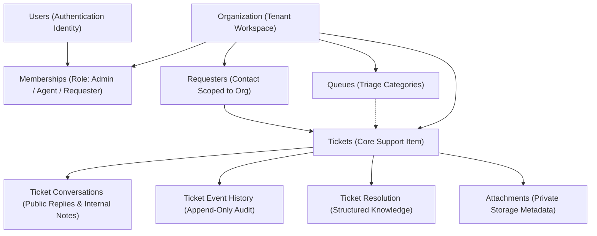

# Community Service Desk - Architecture Specification

**Version:** 0.1.0  
**License:** AGPL-3.0-only  
**Target Environment:** Python 3.14+, PostgreSQL 17+, FastAPI, SQLAlchemy 2.x

---

## 1. Architectural Mission

Community Service Desk (CSD) is a lightweight, production-minded ticketing and support system designed for community organizations, schools, associations, nonprofits, small businesses, and internal support teams.

Beyond standard issue tracking, CSD is architected around a core long-term premise:

> **Every resolved ticket should make the system better at helping resolve the next ticket.**

Structured resolution knowledge is captured upon ticket resolution and indexed for immediate deterministic search today, laying the foundation for an authorized, advisory AI assistance layer in future releases.

---

## 2. Core Domain Model

The domain hierarchy strictly enforces workspace separation and clear relational boundaries:

### Entity Responsibilities

1. **Organization:**
   - Multi-tenant boundary anchor (`id`, `name`, `slug`, `status`).
   - All private assets (tickets, queues, requesters, resolutions, attachments) strictly link to an `organization_id`.
2. **Users and Memberships:**
   - Authenticated accounts with secure cryptographic password hashes (scrypt).
   - Roles scoped per organization: `organization_admin`, `agent`, `requester`.
3. **Requesters:**
   - Represents the individual or organization member seeking support. Scoped to the organization without requiring support agent privileges.
4. **Queues:**
   - Logical organizational groups for routing and team filtering (e.g. IT, Facilities, General Support).
5. **Tickets:**
   - Central work item with unique organization-scoped human-readable ticket numbers (e.g. `CSD-000001`) and non-guessable UUIDs.
6. **Ticket Conversations:**
   - Chronological message stream with strict separation between `REQUESTER_VISIBLE_REPLY` and `INTERNAL_NOTE`.
7. **Ticket Event History:**
   - Append-only immutable log tracking state transitions, assignments, replies, and resolutions.
8. **Ticket Resolution:**
   - Structured outcome recording summary, root cause, steps, verification method, and knowledge usefulness marker.
9. **Attachments:**
   - Metadata tracking files stored in private local filesystem storage or future S3-compatible buckets.

---

## 3. Technology Stack & Decision Rationale

| Layer | Technology | Decision Rationale |
|---|---|---|
| **Runtime** | Python 3.14+ | Modern typing, high performance, long-term supportability. |
| **API Framework** | FastAPI | High throughput async/sync execution, automatic OpenAPI v3 documentation, dependency injection. |
| **Database** | PostgreSQL 17+ / SQLAlchemy 2.0 | Proven ACID transactional consistency, robust full-text search, relational integrity, zero-lock migrations. |
| **Migrations** | Alembic | Version-controlled, idempotent schema upgrades and downgrades from scratch. |
| **Data Validation** | Pydantic v2 | High-performance Rust-backed schema validation and serialization. |
| **Frontend UI** | Semantic HTML5, CSS3, Jinja2 | Fast server rendering, zero heavy JavaScript build pipelines, accessible, responsive across desktop and mobile. |
| **Authentication** | Cryptographic scrypt + JWT | Resistant to GPU brute-force attacks, constant-time verification, stateless bearer and secure cookie support. |

---

## 4. Multi-Tenant Organization Isolation

Tenancy is never left to client-side filters. Server-side isolation principles:

1. **Mandatory Tenant Scoping:** Every database query for private records filters on `organization_id`.
2. **Concealment on Foreign Identifiers:** Direct requests for objects belonging to another organization return HTTP `404 Not Found` (rather than revealing the existence of the foreign object).
3. **Context Resolution:** The organization context is determined via session cookies, request headers (`X-Organization-ID`, `X-Organization-Slug`), or user membership bindings, and verified on every request.

---

## 5. Storage Abstraction

Ticket attachments are handled via the `AttachmentStorageService` abstraction:
- Large binary files are **never** stored directly in PostgreSQL columns.
- Files are saved with cryptographically random UUID storage keys outside public web roots.
- Content types and dangerous executable extensions (`.exe`, `.bat`, `.sh`, `.vbs`, etc.) are blocked on ingestion.
- Downloads require prior ticket-level and tenant-level authorization checks before streaming bytes.
