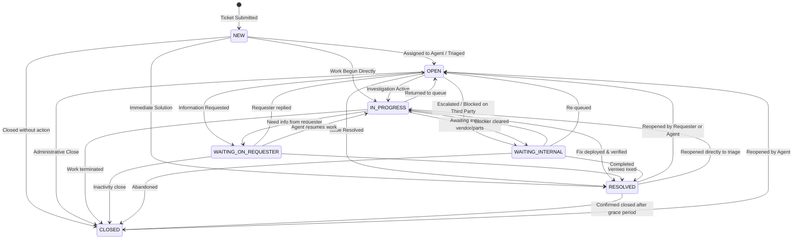

# Community Service Desk - Ticket Lifecycle & Workflow Specification

**Version:** 0.1.1  
**License:** AGPL-3.0-only  

---

## 1. Lifecycle Overview

Community Service Desk models tickets through a deterministic, auditable state machine. Every change in ticket status, assignment, queue, priority, conversation, or resolution appends an immutable event record to the ticket audit trail.

---

## 2. State Machine & Status Definitions

### Status Descriptions

| Status | Meaning | Typical Next Action |
|---|---|---|
| `NEW` | Ticket submitted, pending initial review. | Assign to agent or move to `OPEN`. |
| `OPEN` | Triaged and queued; work assigned but not actively in diagnostic flight. | Begin investigation (`IN_PROGRESS`). |
| `IN_PROGRESS` | Agent is actively diagnosing, troubleshooting, or resolving. | Communicate, test fix, or request information. |
| `WAITING_ON_REQUESTER` | Support team has asked for clarification, logs, or confirmation. | Awaiting requester reply. |
| `WAITING_INTERNAL` | Work is blocked internally (e.g. procurement, physical access, vendor). | Clear internal dependencies. |
| `RESOLVED` | Solution implemented and verified via structured resolution. | Requester confirmation; transition to `CLOSED`. |
| `CLOSED` | Work complete and ticket archived. | Can be reopened to `OPEN` if issue recurs. |

---

## 3. Assignment Workflow

- **Initial State:** Tickets start as `Unassigned`.
- **Assignment:** Agents or administrators assign tickets to a specific staff member. Initial assignment from `NEW` automatically transitions status to `OPEN`.
- **Reassignment:** Tickets may be reassigned between staff members as work shifts.
- **Audit:** All assignment mutations log old and new assignee names to `ticket_event_history`.

---

## 4. Structured Resolution Process

When a ticket is resolved, the agent completes a structured resolution record. This structure serves as the foundation for the institutional knowledge base and future AI assistance:

1. **Resolution Summary:** A clear, concise explanation of what fixed the problem.
2. **Root Cause:** (Optional) Underlying technical, configuration, or operational cause.
3. **Resolution Steps:** Actionable step-by-step description of the fix performed.
4. **Verification Method:**
   - `requester_confirmed`: Requester verified the resolution works.
   - `admin_verified`: Administrator or agent directly tested on system.
   - `automated_test_passed`: Diagnostic script or health check succeeded.
   - `no_longer_reproducible`: Issue vanished or was transient.
   - `workaround_confirmed`: Temporary workaround validated.
5. **Knowledge Usefulness Marker:**
   - Boolean flag indicating whether the fix is reusable for similar future tickets.
   - Preserved within the tenant workspace; **never** automatically published publicly.

---

## 5. Append-Oriented Event History

Every change to a ticket generates an immutable record in `ticket_event_history`:
- `TICKET_CREATED`
- `STATUS_CHANGED`
- `PRIORITY_CHANGED`
- `QUEUE_CHANGED`
- `ASSIGNMENT_CHANGED`
- `PUBLIC_REPLY_ADDED`
- `INTERNAL_NOTE_ADDED`
- `RESOLUTION_RECORDED`
- `TICKET_REOPENED`
- `TICKET_CLOSED`

Each record captures `actor_id`, `actor_name`, `actor_type`, `old_value`, `new_value`, optional JSON metadata, and UTC timestamp. The audit trail is read-only in the UI.
